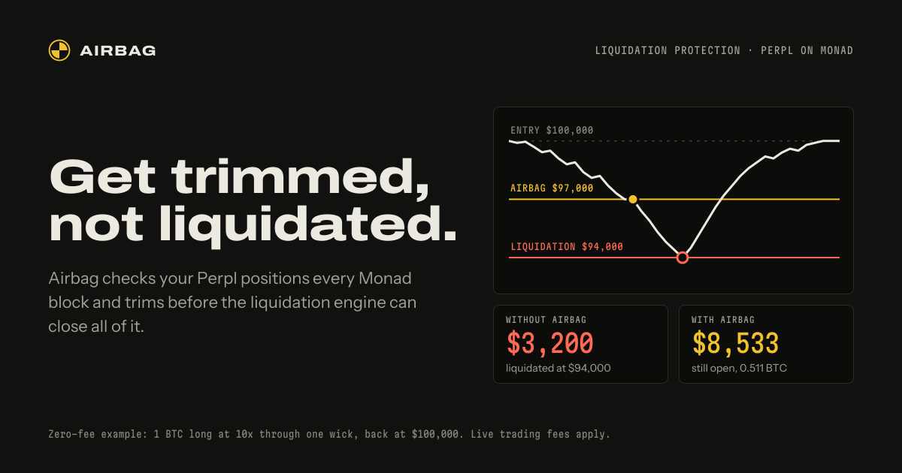
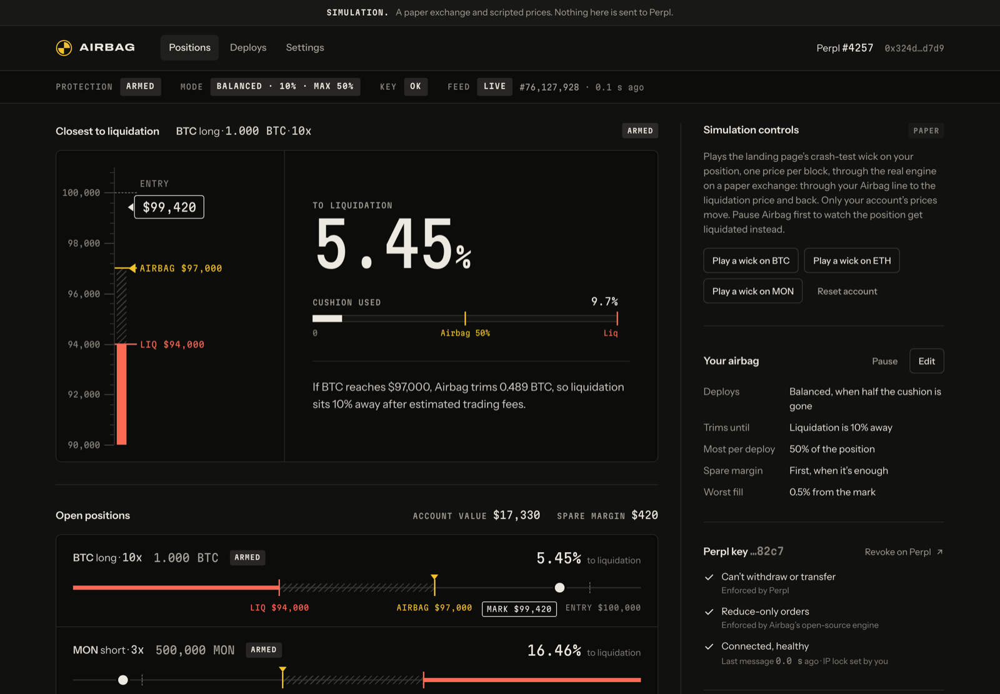
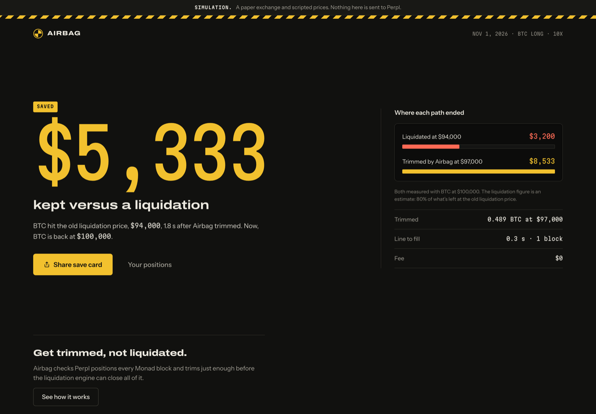
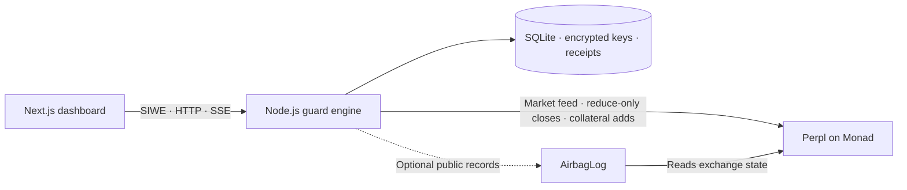

<p align="center">
  
</p>

<h1 align="center">Airbag</h1>

<p align="center">
  <strong>Get trimmed, not liquidated.</strong><br />
  Position protection for Perpl traders on Monad.
</p>

<hr />

<a href="https://airbag.user64bit.world/connect">
  
</a>

**Position protection for [Perpl](https://app.perpl.xyz) traders on [Monad](https://monad.xyz).**
Set your risk line. Airbag watches covered positions block by block, reduces exposure when the
line is crossed, and puts the released collateral behind the remaining position. If spare margin
alone can reach your target, it adds that instead.

[Try the simulation](https://airbag.user64bit.world/connect) ·
[Explore historical replays](https://airbag.user64bit.world/backtest) ·
[Read the docs](docs/README.md) ·
[Contribute](CONTRIBUTING.md)

> **Simulation is open. Mainnet protection is not.** The public app uses paper accounts and
> scripted prices: no funds, wallet extension or real API key needed. Live closes and collateral
> re-adds have been recorded on **Perpl testnet**. Price gaps, fees, thin books and outages can
> still prevent protection. [Evidence and release gates →](docs/VERIFICATION.md)

## Keep the position, not all the exposure

A liquidation closes the position. Airbag aims to reduce it before that happens, leaving a
smaller position with more room to survive. This is not a stop-loss that simply exits at a price.

- **A line you can understand.** Early, Balanced and Late policies act after one-third, one-half
  or three-quarters of the reference margin cushion is used. Preview the trim before arming.
- **Less size, more runway.** Calculate the trim needed for your target liquidation distance,
  subject to your size cap; then re-add the net released collateral. A close alone is not enough.
- **Spare margin when it helps.** Use only the amount needed when free balance can reach the
  target without a trim; otherwise leave it available and reduce exposure.
- **Receipts, not a green light.** Inspect fills, fees, collateral movements, transaction links
  and the block-by-block timeline. See whether an action became a save or a precaution.
- **Explicit failure states.** Stale data, rejected keys, disabled forwarding and recovery holds
  appear in the dashboard. The engine persists in-flight execution state for restart recovery.

Your collateral stays on Perpl. Airbag stores an encrypted Trade key; Perpl API keys cannot
withdraw or transfer, but a compromised Trade key can still trade the account into a loss.
[Security and limitations](docs/SECURITY.md) explain the boundary.

### The dashboard is the risk model, made visible



*Yellow is the Airbag line. Red is liquidation. These are paper positions, not live trading results.*

## Try one wick, both ways

The quickest way to understand Airbag is to let the same paper position fail, then protect it.

1. Open [Connect](https://airbag.user64bit.world/connect), choose **Connect a test wallet**, and
   sign in. The test wallet works in the browser without an extension.
2. Choose **Use a test key**, select **Verify key**, then **Set your airbag**. Review the preview
   and arm Airbag.
3. **Pause** protection, then select **Play a wick on BTC**. Watch the paper position liquidate.
4. Select **Reset account**, **Resume** Airbag, and play the BTC wick again. Follow the close,
   collateral re-add and resulting save report.

ETH demonstrates spare-margin protection; MON demonstrates a short. Wicks and resets affect only
your simulated wallet. The clock follows Monad testnet blocks when available, with a labeled local
fallback. [The user guide](docs/USER-GUIDE.md) covers setup, settings and troubleshooting.

### Every action has a story you can inspect



*A scripted, zero-fee example, measured after BTC returns to $100,000—not realized profit or a
live fill. Liquidation proceeds are estimated. A **save** requires the old liquidation price to
be reached while the position stays open; an action closed before that is a **precaution**.*

## Why the collateral re-add matters

Perpl reduces the position's deposit pro rata when size is closed. **Trimming alone leaves the
liquidation price where it was** in the zero-fee model. Airbag's protection operation is:

1. **Evaluate.** Read current position, mark, funding and fees; check the configured risk line.
2. **Choose.** Add the smallest sufficient spare-margin amount, or calculate a capped trim.
3. **Execute.** Send an IOC reduce-only close, then re-add its net released collateral to the
   remaining position. The close and re-add are separate orders, not an atomic operation.
4. **Reconcile and re-arm.** Confirm outcomes from account state, record the receipt, and establish
   the next reference cushion. If execution fails, report it rather than claim success.

Live fees, execution price and partial fills affect the result. Pausing, losing the connection or
restarting between orders can leave a re-add pending. [The risk model](docs/RISK-MODEL.md) contains
the equations, rounding rules, golden vectors and replay assumptions.

## Evidence you can inspect—and its limits

The repository includes historical replays of Perpl's own mainnet liquidation and position events,
using the real guard against recorded marks on a paper exchange.

- **369 liquidations replayed:** the Airbag line was crossed first in all 369; 363 trimmed
  positions remained open at the original liquidation block. Six were too small to trim within
  the configured cap.
- **The cost side is included:** among 398 included positions that crossed their line but did
  not liquidate, protection reduced aggregate value by $860. Trimming can miss a recovery.
- **Live testnet execution is separate evidence:** recorded closes, collateral re-adds and
  AirbagLog transactions demonstrate the protocol path, not sustained production reliability.

These are dated results over blocks **104,301,446–110,301,445**, not a forecast. Simulated fills
assume a two-block delay, 25 bps adverse execution and context-derived fees; they do not prove
historical book depth. [Read the methodology and exclusions](docs/RISK-MODEL.md#backtest-on-perpls-own-liquidations)
or [browse the replay pages](https://airbag.user64bit.world/backtest).

## Run it locally

Use **Node.js 24** (`.nvmrc` pins `24.21.0`) and **pnpm 11.24.0** (`package.json`). No exchange
account, real key, Docker or environment file is needed for the simulation.

```bash
git clone https://github.com/0xuser64bit/airbag.git
cd airbag
pnpm install --frozen-lockfile
pnpm dev:engine
```

In a **second terminal**, from the repository root:

```bash
pnpm dev:web
```

Open **<http://localhost:3000/connect>**. The engine listens at `http://localhost:8787`.
Check its readiness with `curl -fsS http://localhost:8787/ready`.

Need pnpm? `npm install --global pnpm@11.24.0` installs the pinned version. Prefer not to install
it globally? Use `npx --yes pnpm@11.24.0` in place of `pnpm` in the commands above.

<details>
<summary><strong>Environment files, clocks and port overrides</strong></summary>

`pnpm dev:engine` loads `.env.example`, then optional overrides from the root `.env`. Its supplied
defaults select simulation. Running the engine directly or using the workspace `start` command
does **not** load those template defaults; standalone mode defaults to live and requires a master key.

For an offline engine clock, run `SIM_CLOCK=local pnpm dev:engine`. Leave external alert providers
unconfigured. Public web data panels may still attempt network reads.

Next.js does **not** load the root `.env`. Put web overrides in `apps/web/.env.local` or the web
process environment. `NEXT_PUBLIC_*` settings are fixed at build time. If the engine port changes,
update `NEXT_PUBLIC_ENGINE_URL`; if the web origin changes, update the engine's `WEB_ORIGIN` too.
Never put exchange secrets or master keys in web settings.

</details>

## Under the hood



The browser, simulation, replay and live guard share `packages/risk`. The exchange adapter checks
an order allowlist immediately before send. Optional onchain records and indexing sit outside the
protection loop; their absence must not block a trim. The engine is one process on one host,
not a high-availability service. [Architecture and trust boundaries](docs/ARCHITECTURE.md).

| Path | Responsibility |
|---|---|
| [`apps/engine`](apps/engine) | Guard, API, key vault, SQLite, alerts, simulation and replay |
| [`apps/web`](apps/web) | Next.js dashboard, onboarding, receipts, wallet lookup and replay pages |
| [`packages/risk`](packages/risk) | Pure risk calculations and shared number formatting |
| [`packages/perpl`](packages/perpl) | Exchange connections, chain reads, units and order allowlist |
| [`contracts`](contracts/README.md) | AirbagLog: optional records with exchange-state checks, no funds |
| [`indexer`](indexer/README.md) | Optional Envio indexing for records and liquidation statistics |
| [`tools`](tools) | Protocol checks, replay generation and testnet-only order verification |
| [`e2e`](e2e) · [`deploy/vm`](deploy/vm) | Browser/accessibility checks and VM operations |

## Build, test, contribute

```bash
pnpm check
pnpm build
```

`check` runs lint, TypeScript, and unit/property tests. Browser checks, contracts and the optional
indexer have additional prerequisites; [CONTRIBUTING.md](CONTRIBUTING.md) gives the exact commands
and production browser profile. CI also audits dependencies, scans secrets and smoke-tests the
engine image.

## Go deeper

| I want to… | Read |
|---|---|
| Use Airbag and understand a receipt | [User guide](docs/USER-GUIDE.md) |
| Understand the calculations or reproduce a replay | [Risk model](docs/RISK-MODEL.md) |
| Work on the engine or integrate with it | [Architecture](docs/ARCHITECTURE.md) · [HTTP API](docs/API.md) |
| Understand the exchange protocol | [Perpl integration](docs/PERPL.md) |
| Run, back up or recover a deployment | [Operations](docs/DEPLOY.md) · [Security](docs/SECURITY.md) |
| Separate evidence from release claims | [Verification status](docs/VERIFICATION.md) |

[All documentation](docs/README.md) · [Web design contract](apps/web/DESIGN.md) · [MIT license](LICENSE)

Development uses AI coding assistance. Tests, replays and recorded testnet runs are not a substitute
for independent review of code that can trade an account.
