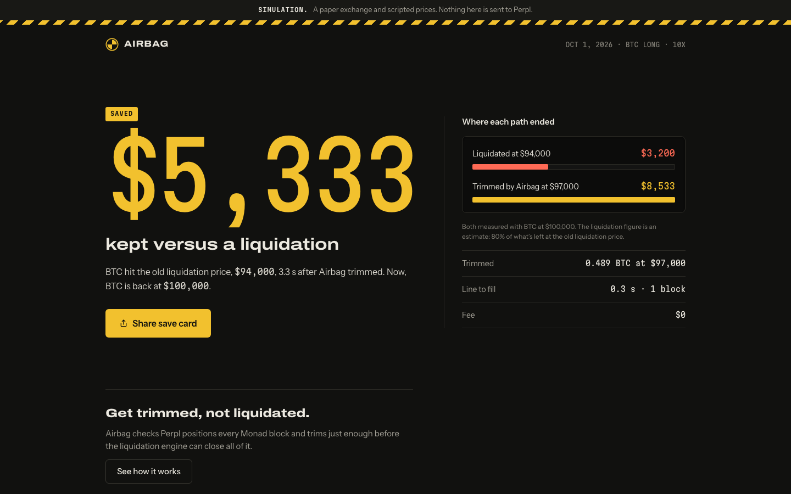

# Airbag

**Get trimmed, not liquidated.** Liquidation protection for [Perpl](https://perpl.xyz) traders on
[Monad](https://monad.xyz).

Airbag checks your Perpl positions every Monad block. When a price move uses up a set share of a
position's margin cushion, it trims with a reduce-only order and puts the net released margin back
in to move liquidation further away. Trading fees, slippage and outages still matter; protection
is not guaranteed. It acts through a Perpl API key that cannot withdraw.


*A simulated deploy on Monad testnet's real blocks: the line is crossed in block 67,239,006, the
reduce-only close fills in the next block, the released margin goes back in the one after, and
the old liquidation price is reached while the trimmed position is still open. The public save
report it produced:*



## Why it works

- Perpl can liquidate all or part of a position; the default split of remaining proceeds is 80% to the
  trader, 10% to the insurance fund, 10% to the protocol. On mainnet that happened 160 times in the
  3,000,000 blocks (about ten days) to 2026-10-01, and each full liquidation returned exactly 80% of
  what was left, read from Perpl's own `PositionLiquidated` events.
- Closing or reducing pays Perpl's trading fee. Airbag reads the taker schedule and fee tier,
  estimates the net trim size, and records observed fees.
- An early partial close can preserve the remaining trade. The benefit depends on fees, fills,
  funding and the market path, rather than a promise of zero cost.

Perpl shrinks a position's deposit pro-rata when it's reduced, so a close on its own leaves the
liquidation price where it was. A deploy is therefore two orders: the reduce-only close, then
`IncreasePositionCollateral` with the margin the close released
([ADR 0002](docs/adr/0002-deploy-is-close-then-readd.md)). The zero-fee simulation example: a 1 BTC long from
$100,000 at 10x trims 0.489 BTC at $97,000, liquidation moves from $94,000 to $87,300, and if BTC
then wicks to $94,000 and back, the trader holds $8,533 instead of the $3,200 a liquidation returns.
Every number in that example is a golden test vector in
[docs/RISK-MODEL.md](docs/RISK-MODEL.md).

## Why Monad

- **Per-block checks are worth doing at 300 ms blocks.** A line crossed in block *k* is acted on
  around *k + 1*, while the price is still near the line rather than near liquidation.
- **Perpl is a fully onchain order book**, so a trim is a real fill with a Monad transaction anyone
  can look up. Trim estimates account for trading fees.
- **An onchain log.** Every deploy and save can be written to the `AirbagLog` contract and indexed
  by Envio, so Airbag's record is public and checkable, not a database row.

## Status

**Works end to end in simulation**, in CI and in a browser: connect, sign in, link a key, arm, and
a wick through the real engine that trims, re-adds, re-arms and records a save. The prices are
scripted; the blocks are Monad testnet's own, so a simulated deploy's block log can be opened on
the explorer.

**Checked against Perpl and Monad testnet without a key** (2026-10-01,
[details](docs/PERPL.md#checked-against-testnet-on-2026-10-01-without-a-key)): the live engine boots
on Perpl's context, fees, funding and feeds and reports ready a block behind Monad; it reads real
traders' accounts from the chain; and its position math reproduces the contract's own unrealized
PnL to under $0.0001 on 19 testnet positions and on 37 real traders' positions on Perpl mainnet,
in 10 markets. Three of those mainnet traders were under 3% from liquidation. And against Perpl's
own liquidation engine: in **159 real mainnet liquidations**, Perpl never liquidated a position
before the mark reached the liquidation price Airbag computes for it, and the trader got exactly
80% of what was left every time, the figure Airbag's save reports assume. Both checks are
commands anyone can rerun: `pnpm --filter @airbag/spike check` and
`pnpm --filter @airbag/spike liquidations` ([how](docs/PERPL.md#checked-against-testnet-on-2026-10-01-without-a-key)).

**Not done yet:** Airbag has **not traded on Perpl**. A real trim and re-add needs a disposable
funded testnet wallet and a Trade key ([runbook](docs/DEPLOY.md#demo-day-a-real-deploy-on-perpl-testnet)).
Nothing is hosted and no contract is deployed. Independent review comes before anyone relies on
it with real money. Audit history, backlog and launch gates: [docs/MVP-AUDIT.md](docs/MVP-AUDIT.md).

## What's here

| Path | What |
|---|---|
| `packages/risk` | The risk math, pure and dependency-free: liquidation price, the Airbag line, deploy planning, the save value. Golden vectors plus property tests. |
| `packages/perpl` | Perpl client: trading and market-data sockets, Ed25519 sign-in, onchain reads, safe unit conversion, and the order-type allowlist (only closes, margin adds, and a link-time scope probe). |
| `apps/engine` | The always-on engine: one guard per account, per-block checks, deploys, re-arming and saves; the HTTP API (SIWE, key linking, settings, live stream); SQLite; Web Push; the AirbagLog writer; simulation mode. |
| `apps/web` | The site and app (Next.js): landing page with the crash-test replay, onboarding, dashboard, deploy receipts, public save reports with a share image; installable for push alerts. |
| `contracts/` | `AirbagLog`, a public append-only log of deploys and saves (Foundry). |
| `indexer/` | Envio HyperIndex over AirbagLog and Perpl's liquidations. |
| `e2e/` | Playwright journeys with axe accessibility checks. |
| `spike/` | Testnet scripts: a keyless check of the position math against the contract, feed measurements, and the funded verification run. |
| `design/` | The approved design, as reference artboards. |

## Run it

Node 24 and pnpm 11. Docker is only needed for the contract tests.

```bash
pnpm install --frozen-lockfile
pnpm dev:engine    # the engine on :8787: .env.example's defaults (simulation), then your .env
pnpm dev:web       # the app on :3000
```

Open http://localhost:3000/connect. In simulation, "Connect a test wallet" is a throwaway key held
by the page, so the whole flow can be clicked through without a browser extension; an injected
wallet such as Rabby or MetaMask works too. Sign in, use "Use a test key", arm, and press "Play a
wick on BTC" on the dashboard: the engine trims, re-adds, re-arms and records a save, and the save
report has a share card. Everything is labelled as simulated. Each wallet has its own simulated
prices, so visitors to one engine never move each other's positions, and "Reset account" puts
that wallet back to the start.

The prices are scripted, but the blocks are real: simulation follows Monad testnet's own block
clock through Perpl's public heartbeat (it never sends anything to Perpl), so each deploy's block
log and the dashboard's block number are Monad blocks you can open on the explorer. If that feed
goes quiet, a local clock fills in; `SIM_CLOCK=local` stays offline.

Configuration is `.env` (copy `.env.example`); nothing is needed for simulation. To point the engine
at Perpl testnet, set `ENGINE_MODE=live`, a `MASTER_KEY` and `PERPL_NETWORK=testnet`, then link a
Trade key from the app whose IP allow-list includes the engine's egress IPs.

## Test

```bash
pnpm check                                          # lint, typecheck, unit and property tests
pnpm e2e                                            # Playwright + axe against the engine in simulation
pnpm contracts:test                                 # Foundry, via Docker
pnpm --filter @airbag/indexer codegen && pnpm --filter @airbag/indexer test
```

CI runs all of these, plus gitleaks over the full history, `pnpm audit`, and a build and smoke test
of the engine image.

## Documentation

| Document | What it answers |
|---|---|
| [docs/ARCHITECTURE.md](docs/ARCHITECTURE.md) | How the system fits together, the per-block loop, the invariants, the known limits |
| [docs/MVP-AUDIT.md](docs/MVP-AUDIT.md) | Prioritized hardening backlog, actual verification, remaining launch gates and manual checks |
| [docs/RISK-MODEL.md](docs/RISK-MODEL.md) | The arithmetic, the deploy algorithm, the golden test vectors |
| [docs/PERPL.md](docs/PERPL.md) | Verified Perpl, Monad and Envio protocol facts, and the gotchas that have cost time |
| [docs/SECURITY.md](docs/SECURITY.md) | The threat model, the controls, master-key rotation and a leak |
| [docs/DEPLOY.md](docs/DEPLOY.md) | Testnet verification, then the engine on Fly and the web app on Vercel |
| [docs/adr/](docs/adr/) | Why each major decision went the way it did |
| [apps/web/DESIGN.md](apps/web/DESIGN.md) | The web app's design system and content contract |
| [CONTRIBUTING.md](CONTRIBUTING.md) | Commands, conventions, and what not to weaken |

## AI disclosure

This project is built with AI coding tools, as the hackathon rules allow. What was made by whom:

| Part | Written by | Reviewed by the owner |
|---|---|---|
| Product definition and approved design ([design/](design/)) | Owner (Arth). _Owner: say here which tools, if any, helped._ | n/a |
| Research, ADRs, and the documentation in `docs/`, [apps/web/DESIGN.md](apps/web/DESIGN.md) | Claude Code (Anthropic, Claude Opus 5.5) | Pending |
| Original code, tests and CI through `46d3a4b` | Claude Code (Anthropic, Claude Opus 5.5) | Pending |
| 2026-09-27 audit, security/reliability/fee corrections, browser resilience, tests and operations documentation | Codex (OpenAI, GPT-6) | Pending |
| 2026-10-01 live checks against testnet, live-path fixes, per-wallet simulation on Monad's block clock, demo deployment and docs | Claude Code (Anthropic, Claude Opus 5.5) | Pending |

Commits carry no co-author trailer, at the owner's request, so the table above is the disclosure of
record. It is updated as the owner reviews each part.

## License

[MIT](LICENSE)
