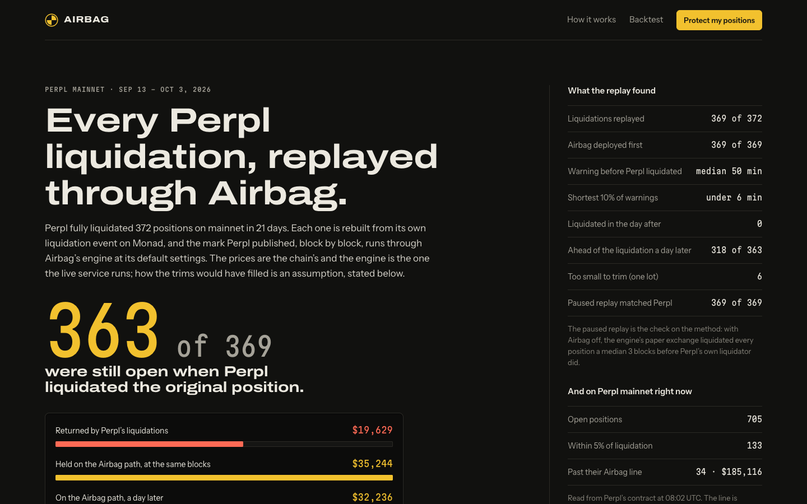
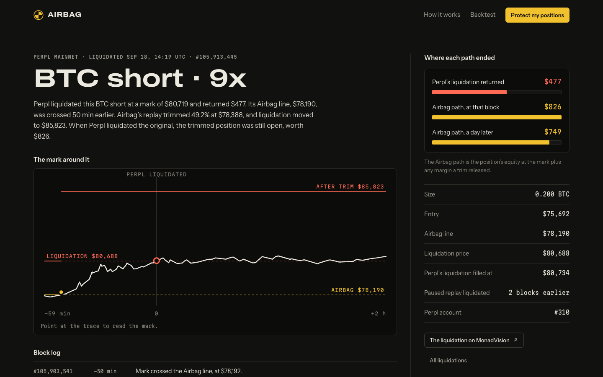

# Airbag

**Get trimmed, not liquidated.** Liquidation protection for [Perpl](https://perpl.xyz) traders on
[Monad](https://monad.xyz).

Airbag checks your Perpl positions every Monad block. When a price move uses up a set share of a
position's margin cushion, it trims with a reduce-only order and puts the net released margin back
in to move liquidation further away. Trading fees, slippage and outages still matter; protection
is not guaranteed. It acts through a Perpl API key that cannot withdraw.

**Try it: https://airbag.user64bit.world** — the simulation, no wallet extension needed:
"Connect a test wallet", "Use a test key", arm, then "Play a wick on BTC" (or ETH, or the MON
short) on the dashboard. The wick is shaped to your position: through its Airbag line to its
liquidation price and back. Play it with Airbag paused first and the position is liquidated
instead; "Reset account" puts it back. Turn on "Push to this browser" in Settings first and the trim and the save arrive as
notifications. The exchange is paper and the prices are scripted; the blocks are Monad testnet's
own.

**In five minutes:**

1. **[The backtest](https://airbag.user64bit.world/backtest)**: every position Perpl mainnet
   liquidated over three weeks, rebuilt from its liquidation event and replayed block by block
   through Airbag's engine. 363 of 369 would have been trimmed in time and still open when Perpl
   liquidated them; each has its own page with the real mark, the trim and the transaction.
2. **[The demo](https://airbag.user64bit.world/connect)**: play a wick with Airbag paused (the
   position is liquidated), reset, arm, play it again (trimmed, margin back, saved).
3. **The landing's live radar**: how many open Perpl mainnet positions are past the line where
   Airbag would already have trimmed them, read from Perpl's contract every few minutes, and
   **[a wallet check](https://airbag.user64bit.world/wallet)**: any Perpl wallet's positions now,
   where Airbag would act on each, and its liquidations replayed.
4. **[AirbagLog](contracts/README.md)**: a contract that reads Perpl's positions on Monad to check
   Airbag's own records, tested against Perpl's real mainnet Exchange on a fork and
   [deployed on Monad testnet](https://testnet.monadvision.com/address/0x52259e30d3687691F663033922472B43120276F7).



*One of the 369, a real BTC short Perpl liquidated on 2026-09-18: the replay trimmed it at the
Airbag line 50 minutes earlier, liquidation moved to $85,823, and when Perpl liquidated the
original at $80,719 the trimmed position was still open, worth $826 against the $477 returned:*




*A simulated deploy on Monad testnet's real blocks: the line is crossed in block 67,459,596, the
reduce-only close fills in the next block, the released margin goes back in the one after, and
the old liquidation price is reached five blocks later while the trimmed position is still open.
The public save report it produced, with its share card one click away:*


## Why it works

- Perpl can liquidate all or part of a position; the default split of remaining proceeds is 80% to the
  trader, 10% to the insurance fund, 10% to the protocol. On mainnet that happened 160 times in the
  3,000,000 blocks (about ten days) to 2026-10-01, and each full liquidation returned exactly 80% of
  what was left, read from Perpl's own `PositionLiquidated` events.
- Closing or reducing pays Perpl's trading fee. Airbag reads the taker schedule and fee tier,
  estimates the net trim size, and records observed fees.
- An early partial close can preserve the remaining trade. The benefit depends on fees, fills,
  funding and the market path, rather than a promise of zero cost.

Perpl shrinks a position's deposit pro-rata when it's reduced, so a close on its own leaves the
liquidation price where it was. A deploy is therefore two orders: the reduce-only close, then
`IncreasePositionCollateral` with the margin the close released
([ADR 0002](docs/adr/0002-deploy-is-close-then-readd.md)). The zero-fee simulation example: a 1 BTC long from
$100,000 at 10x trims 0.489 BTC at $97,000, liquidation moves from $94,000 to $87,300, and if BTC
then wicks to $94,000 and back, the trader holds $8,533 instead of the $3,200 a liquidation returns.
If instead it keeps falling to $87,300, the smaller position is liquidated too and returns $1,635,
less than the first liquidation would have, because the released margin went back in: Airbag pays
off when a wick turns. Every number in that example is a golden test vector in
[docs/RISK-MODEL.md](docs/RISK-MODEL.md).

## Why Monad

- **Per-block checks are worth doing at 300 ms blocks.** A line crossed in block *k* is acted on
  around *k + 1*, while the price is still near the line rather than near liquidation.
- **Perpl is a fully onchain order book**, so a trim is a real fill with a Monad transaction anyone
  can look up. Trim estimates account for trading fees.
- **A log that checks itself.** Perpl's positions live in a contract, so `AirbagLog` reads them in
  the same transaction: a deploy's size and liquidation price after come from Perpl, not from
  Airbag, and anyone can prove a save against Perpl's own mark
  ([ADR 0016](docs/adr/0016-airbaglog-reads-perpl.md)). Its `liquidationPrice` view works for any
  Perpl position. Indexed by Envio.
- **Public data deep enough to test against.** Every liquidation and every mark update is a Monad
  event, which is what makes the backtest of Perpl's own liquidations possible.

## Status

**Works end to end in simulation**, in CI and in a browser: connect, sign in, link a key, arm, and
a wick through the real engine that trims, re-adds, re-arms and records a save. The prices are
scripted; the blocks are Monad testnet's own, so a simulated deploy's block log can be opened on
the explorer.

**Checked against Perpl and Monad testnet without a key** (2026-10-01,
[details](docs/PERPL.md#checked-against-testnet-on-2026-10-01-without-a-key)): the live engine boots
on Perpl's context, fees, funding and feeds and reports ready a block behind Monad; it reads real
traders' accounts from the chain; and the guard's own position conversion reproduces the
contract's unrealized PnL and funding to under $0.0001 on real testnet positions and on 42 real
traders' positions on Perpl mainnet, in 10 markets. Three of those mainnet traders were under 3% from liquidation. And against Perpl's
own liquidation engine: in **159 real mainnet liquidations**, Perpl never liquidated a position
before the mark reached the liquidation price Airbag computes for it, and the trader got exactly
80% of what was left every time, the figure Airbag's save reports assume. Both checks are
commands anyone can rerun: `pnpm --filter @airbag/spike check` and
`pnpm --filter @airbag/spike liquidations` ([how](docs/PERPL.md#checked-against-testnet-on-2026-10-01-without-a-key)).

**Replayed against every Perpl mainnet liquidation** (2026-10-04,
[the results](https://airbag.user64bit.world/backtest), [method](docs/RISK-MODEL.md#backtest-on-perpls-own-liquidations)):
each of the 372 positions Perpl fully liquidated over 21 days is rebuilt from its own
liquidation event, and the marks Perpl published, block by block, run through Airbag's
production engine on a paper exchange at its default settings. Airbag's line was crossed first in
all 369 replayable ones, a median 50 minutes before Perpl liquidated (the fastest tenth, under 6
minutes). **363 trimmed positions were still open when Perpl liquidated the original**, holding
$35,244 at those blocks against the $19,629 the liquidations returned; none reached its new
liquidation price in the day after. The other 6 were single lots, too small to trim within the 50%
cap. A control replay with Airbag paused liquidated all 369 at or before Perpl did, a median 3
blocks early, so the replay agrees with the chain. Fills are the one assumption: two blocks after
the line, 0.25% past the mark, with the taker fee. Rerun it with
`PERPL_NETWORK=mainnet MONAD_RPC_URL=https://rpc1.monad.xyz pnpm --filter @airbag/spike backtest`.

**Live on the landing page**: every few minutes the site reads all open positions on Perpl
mainnet from the contract (about 700 on 2026-10-04) and says how many are past the line where
Airbag would already have trimmed them (40, worth $215,000) and how many are within 5% of
liquidation (136).

**Not done yet:** Airbag has **not traded on Perpl**. A real trim and re-add needs a disposable
funded testnet wallet and a Trade key ([runbook](docs/DEPLOY.md#demo-day-a-real-deploy-on-perpl-testnet)).
The demo above runs on a free VM ([ADR 0015](docs/adr/0015-free-shared-vm.md)). AirbagLog v2 is
deployed on Monad testnet at [`0x52259e30…76F7`](https://testnet.monadvision.com/address/0x52259e30d3687691F663033922472B43120276F7) (2026-10-04, against Perpl's
testnet Exchange); its `liquidationPrice` agreed with the risk package to the tick on 16 of 16 real
testnet positions, and the live engine records into it once it trades. Independent review comes before anyone relies on it with real money. Audit history, backlog and launch gates: [docs/MVP-AUDIT.md](docs/MVP-AUDIT.md).

## What's here

| Path | What |
|---|---|
| `packages/risk` | The risk math, pure and dependency-free: liquidation price, the Airbag line, deploy planning, the save value. Golden vectors plus property tests. |
| `packages/perpl` | Perpl client: trading and market-data sockets, Ed25519 sign-in, onchain reads, safe unit conversion, and the order-type allowlist (only closes, margin adds, and a link-time scope probe). |
| `apps/engine` | The always-on engine: one guard per account, per-block checks, deploys, re-arming and saves; the HTTP API (SIWE, key linking, settings, live stream); SQLite; Web Push and Telegram alerts; the AirbagLog writer; simulation mode, and the replay of recorded mark paths the backtest runs on. |
| `apps/web` | The site and app (Next.js): landing page with the crash-test replay, the backtest of every Perpl liquidation, onboarding, dashboard, deploy receipts, public save reports with a share image; installable for push alerts. |
| `contracts/` | `AirbagLog`, a public append-only log of deploys and saves (Foundry). |
| `indexer/` | Envio HyperIndex over AirbagLog and Perpl's liquidations. |
| `e2e/` | Playwright journeys with axe accessibility checks. |
| `spike/` | Keyless checks against the chain: the position math against the contract, the backtest that replays every Perpl mainnet liquidation through the engine, and Perpl's liquidations against Airbag's liquidation price; feed measurements; the funded verification run. |
| `design/` | The approved design, as reference artboards. |

## Run it

Node 24 and pnpm 11. Docker is only needed for the contract tests.

```bash
pnpm install --frozen-lockfile
pnpm dev:engine    # the engine on :8787: .env.example's defaults (simulation), then your .env
pnpm dev:web       # the app on :3000
```

Open http://localhost:3000/connect. In simulation, "Connect a test wallet" is a throwaway key held
by the page, so the whole flow can be clicked through without a browser extension; an injected
wallet such as Rabby or MetaMask works too. Sign in, use "Use a test key", arm, and press "Play a
wick on BTC" on the dashboard: the engine trims, re-adds, re-arms and records a save, and the save
report has a share card to post, copy or download. "Play a wick on ETH" shows the other path:
spare margin goes in instead of a trim, and "Play a wick on MON" a short: the line sits above the
mark and Airbag buys some of the position back. Everything is labelled as simulated. Each wallet has its own simulated
prices, so visitors to one engine never move each other's positions, and "Reset account" puts
that wallet back to the start.

The prices are scripted, but the blocks are real: simulation follows Monad testnet's own block
clock through Perpl's public heartbeat (it never sends anything to Perpl), so each deploy's block
log and the dashboard's block number are Monad blocks you can open on the explorer. If that feed
goes quiet, a local clock fills in; `SIM_CLOCK=local` stays offline.

Configuration is `.env` (copy `.env.example`); nothing is needed for simulation. To point the engine
at Perpl testnet, set `ENGINE_MODE=live`, a `MASTER_KEY` and `PERPL_NETWORK=testnet`, then link a
Trade key from the app whose IP allow-list includes the engine's egress IPs.

## Test

```bash
pnpm check                                          # lint, typecheck, unit and property tests
pnpm e2e                                            # Playwright + axe against the engine in simulation
pnpm contracts:test                                 # Foundry, via Docker
pnpm --filter @airbag/indexer codegen && pnpm --filter @airbag/indexer test
```

CI runs all of these, plus gitleaks over the full history, `pnpm audit`, and a build and smoke test
of the engine image.

## Documentation

| Document | What it answers |
|---|---|
| [docs/ARCHITECTURE.md](docs/ARCHITECTURE.md) | How the system fits together, the per-block loop, the invariants, the known limits |
| [docs/MVP-AUDIT.md](docs/MVP-AUDIT.md) | Prioritized hardening backlog, actual verification, remaining launch gates and manual checks |
| [docs/RISK-MODEL.md](docs/RISK-MODEL.md) | The arithmetic, the deploy algorithm, the golden test vectors |
| [docs/PERPL.md](docs/PERPL.md) | Verified Perpl, Monad and Envio protocol facts, and the gotchas that have cost time |
| [docs/SECURITY.md](docs/SECURITY.md) | The threat model, the controls, master-key rotation and a leak |
| [docs/DEMO.md](docs/DEMO.md) | Showing Airbag in three minutes: the script, and what judges ask |
| [docs/SUBMISSION.md](docs/SUBMISSION.md) | Ready-to-paste submission text: what it is, the evidence, how it uses Monad |
| [docs/DEPLOY.md](docs/DEPLOY.md) | The demo on the free VM, a real testnet deploy, verification on testnet, operating the VM |
| [docs/adr/](docs/adr/) | Why each major decision went the way it did |
| [apps/web/DESIGN.md](apps/web/DESIGN.md) | The web app's design system and content contract |
| [CONTRIBUTING.md](CONTRIBUTING.md) | Commands, conventions, and what not to weaken |

## AI disclosure

This project is built with AI coding tools, as the hackathon rules allow. What was made by whom:

| Part | Written by | Reviewed by the owner |
|---|---|---|
| Product definition and approved design ([design/](design/)) | Owner (Arth). _Owner: say here which tools, if any, helped._ | n/a |
| Research, ADRs, and the documentation in `docs/`, [apps/web/DESIGN.md](apps/web/DESIGN.md) | Claude Code (Anthropic, Claude Opus 5.5) | Pending |
| Original code, tests and CI through `46d3a4b` | Claude Code (Anthropic, Claude Opus 5.5) | Pending |
| 2026-09-27 audit, security/reliability/fee corrections, browser resilience, tests and operations documentation | Codex (OpenAI, GPT-6) | Pending |
| 2026-10-01 live checks against testnet, live-path fixes, per-wallet simulation on Monad's block clock, demo deployment and docs | Claude Code (Anthropic, Claude Opus 5.5) | Pending |
| 2026-10-02 product pass: one page frame and side bays, the loader, the share dialog and share images, per-position demo wicks, the save-value fix for later spare-margin adds, page titles, and docs | Claude Code (Anthropic, Claude Opus 5.5), from the owner's list and its own review | Pending |
| 2026-10-04 fifth pass: the backtest of Perpl's mainnet liquidations through the engine's replay, paper liquidation, the live radar, the MON short in the demo, AirbagLog checked against Perpl's state with a mainnet fork test, the guard's mid-trim and the risk package's float-noise fixes, and docs ([audit](docs/MVP-AUDIT.md#fifth-pass-evidence-from-the-chain-2026-10-04)) | Claude Code (Anthropic, Claude Opus 5.5), from the owner's brief and its own review | Pending |

Commits carry no co-author trailer, at the owner's request, so the table above is the disclosure of
record. It is updated as the owner reviews each part.

## License

[MIT](LICENSE)
