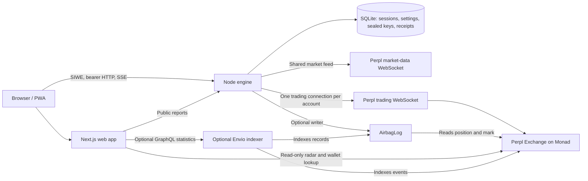

# Architecture

Airbag is a position guard: a web client configures an always-on engine, and the engine acts on
Perpl through a verified Trade key. The shared [risk model](RISK-MODEL.md) decides when to act and
how much collateral or size to move. [Perpl integration](PERPL.md) describes the protocol.

## Components and trust boundaries



The engine owns the only database, master key and path to decrypted Perpl credentials. The web
server reads public reports through the engine and public market data through RPC; it has no
access to sealed keys. The current public deployment runs both services behind Caddy on a shared
VM. That host is suitable for the simulation and disposable testnet keys, not real-money custody.

| Module | Responsibility |
|---|---|
| `packages/risk` | Pure human-unit arithmetic and shared formatting; no I/O or dependencies |
| `packages/perpl` | Context, funding, trading/feed connections, protocol types, chain reads and safe conversions |
| `apps/engine` | Configuration, vault, store, accounts, guards, HTTP API, alerts, optional log writer and replay |
| `apps/web` | Onboarding, dashboard, settings, receipts, public reports, radar, wallet lookup and replay pages |
| `contracts` | Append-only records with Perpl state checks; no funds or trading authority |
| `indexer` | Optional event indexing and aggregate counts |
| `tools` | Read-only protocol checks, historical dataset generation and testnet-only order verification |

## Position lifecycle

A shared Perpl heartbeat drives `Engine.tick(head)` once per observed block. Each linked wallet
has a guard and trading connection. The guard values its positions from current snapshots,
marks, funding and fee schedules, then checks covered positions against their Airbag line.

```mermaid
sequenceDiagram
  participant F as Market feed
  participant G as Account guard
  participant P as Perpl
  participant S as SQLite
  F->>G: New block and current marks
  G->>G: Check safety, policy and position identity
  G->>S: Persist episode and execution deadline
  alt Spare balance alone reaches target
    G->>P: Add smallest required collateral (t:6)
  else Reduce exposure
    G->>P: IOC reduce-only close (t:3 or t:4)
    P-->>G: Order outcome, position and balance updates
    G->>S: Persist exact collateral re-add target
    G->>P: Add net released collateral (t:6)
  end
  P-->>G: Reconciled position snapshot
  G->>S: Receipt, new reference and risk line
  G->>G: Notify; optional onchain record
  Note over G: Later old liquidation-price crossing while same position is open = save
```

Perpl reduces a position's deposit pro rata when size is reduced. Closing alone therefore does
not move the liquidation price; adding the net release back is part of the protection operation.
Partial or missing fills retry within the original episode's size cap and attempt budget. A
failure alerts the trader rather than claiming the target was reached.

Before every dispatch, after any request-budget wait, the guard rechecks pause, freshness,
forwarding, frozen state, account/position identity, side, size and deposit. Episode policy is
fixed for the in-progress operation. Key changes serialize per wallet and are refused while
recovery or a deploy owns the key.

Restart recovery waits beyond a persisted execution deadline, compares fresh snapshots with
pre-order state and exact collateral targets, and defers while protection is unsafe. A lost
acknowledgement is not evidence that the order failed. Recovered fill prices and unattributable
fees remain estimates or unconfirmed values.

## Safety invariants

1. Orders can only close a long/short (`t:3/4`), add collateral (`t:6`), or cancel (`t:5`). Builders,
   a runtime check immediately before sending, and tests enforce the allowlist. The only cancel
   is the link-time scope probe targeting an id outside the account's open-order snapshot.
2. Gateway admission (`mt:3`) is not a fill. Positions, balances and final order updates determine outcomes.
3. No order dispatch while paused, stale, key-rejected, disconnected, frozen or forwarding-disabled.
4. One protection episode per position. Request ids increase from Perpl's last forwarded id;
   explicit order deadlines and recovery locks survive restart.
5. Startup and silent connections are bounded. Request-budget waits are serialized and cancellable;
   streams publish stale state even when the block feed stops.
6. Secrets are encrypted with wallet/account associated data, decrypted only by the engine,
   redacted in logs and never returned by an endpoint.
7. SQLite binds mode and chain id and refuses cross-environment reuse. Existing populated legacy
   files require explicit operator adoption after backup.

## Execution environments

| Mode | Data and orders | Use |
|---|---|---|
| Live | Perpl context, current funding/fees, shared market feed, authenticated trading sockets | Verified testnet trading; mainnet release remains gated |
| Simulation | Same guard/API, paper accounts, per-wallet scripted marks; shared Monad testnet clock with local fallback | Public demonstration and browser checks |
| Replay | Same guard on a paper exchange driven by recorded marks, no HTTP server | Historical liquidation and cost-side datasets |

`SIM_CLOCK=local` runs simulation offline. Simulation controls return 404 in live mode and a
simulation cannot write to a real AirbagLog. Replay jumps between mark updates while idle and
steps each block during orders. The paper exchange liquidates positions before settling that
block's orders; the paused replay is the control.

`/health` reports process/feed diagnostics. `/ready` returns 503 without a fresh feed/tick and is
the deployment and monitoring check. Individual account/key failures belong to dashboard status.
[HTTP API](API.md) lists the endpoints and their trust boundaries.

## Web and public evidence

Next.js App Router renders public pages on the server and live views in client components. The
browser keeps a bearer token in localStorage and reads SSE with streaming `fetch` so it can send
an Authorization header. Public share images render at 1200×675. The web app never stores a pasted key.

The mainnet radar reads open positions at most every five minutes. Wallet lookup is read-only.
Replay pages use committed, dated JSON datasets. Optional indexer and chain reads disappear when
unavailable rather than inventing a count. [User guide](USER-GUIDE.md) describes routes and states;
[Web design](../apps/web/DESIGN.md) defines visual and content conventions.

## Design decisions

| Choice | Reason |
|---|---|
| TypeScript source workspaces on Node 24 | Share tested math/client code without a second engine build pipeline |
| Native HTTP, crypto and SQLite | One writer on one host; no framework, ORM or network database is required |
| SQLite WAL, constraints, append-only migrations | Consistent persistent receipts and recovery state; invalid settings rejected at storage |
| Float64 human units; scaled integers at the exchange boundary | Readable calculations with safe lot/price rounding and exact collateral targets |
| Bearer SIWE sessions | Works across local ports and hosting origins; streaming fetch can authenticate without third-party cookies |
| Injected-wallet discovery and viem | Address/signature flow without an additional wallet state framework |
| CSS variables and modules | Existing components and tokens express the interface directly |
| Paper exchange behind the same exchange interface | Exercise production guard behavior without funds, while labeling model assumptions |
| Optional onchain log/indexer | Public evidence cannot delay or block the protection loop |

## Operating limits

- One engine process on one host: no protection during host or upstream outages; no failover.
- SSE publishes full wallet state each block; throughput is intended for modest account counts.
- Live fee/funding schedules must be known. Fees and book liquidity can change before execution.
- Public save reports cache for 30 seconds. Counterfactual proceeds estimate fills at the old
  liquidation price and use the first covered market's user share, falling back to 80%.
- Concurrent manual trades/collateral moves can make snapshot recovery ambiguous. Sustained
  disposable testnet fault testing and independent review remain release gates.
- The optional writer queue is in memory: failed writes need investigation and are not backfilled
  automatically. AirbagLog checks after-state and current save conditions; before-state is
  writer-attested and a closed/reopened position on the same side cannot be distinguished.
- localStorage sessions remain exposed to XSS. Static Next.js pages require inline scripts in the CSP.

[Operations](DEPLOY.md), [Security](SECURITY.md) and [Verification status](VERIFICATION.md) cover
recovery procedures and release requirements.
