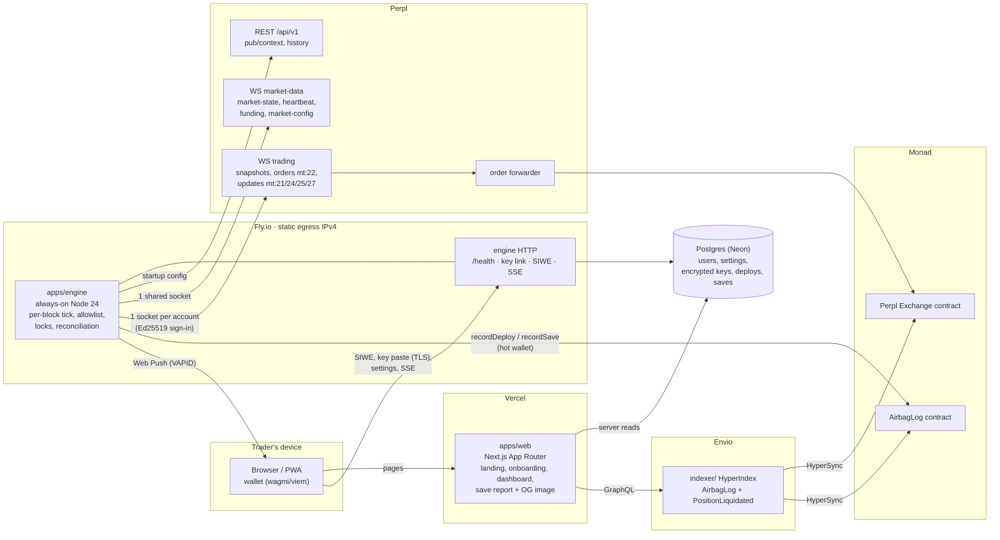
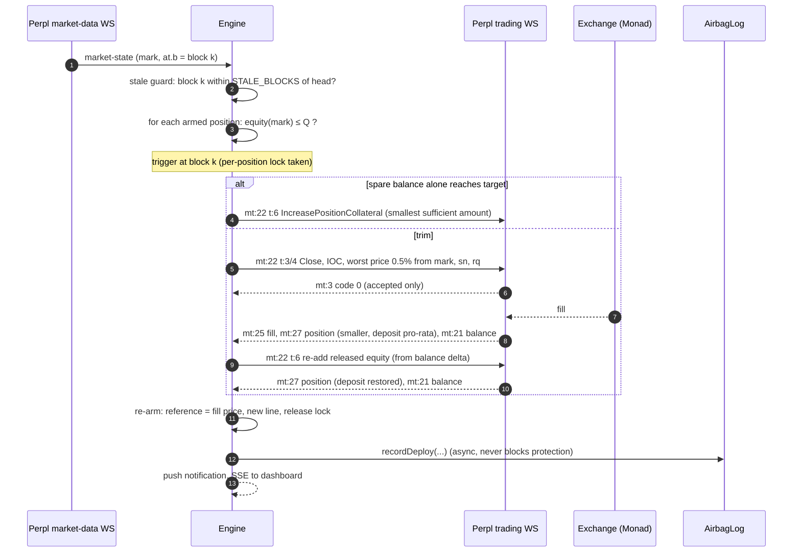

# Architecture

Airbag watches Perpl positions every Monad block and, when a position crosses its Airbag line, trims it with a reduce-only close and re-adds the released margin so the liquidation price moves away. Decisions behind each part are in `docs/adr/`.

## System

## Packages

| Path | What | Depends on |
|---|---|---|
| `packages/risk` | Pure risk math: equity, liquidation price, trigger line, trim sizing, spare-margin check, save classification. No I/O, no dependencies. Runs in the engine and in the browser. | nothing |
| `packages/perpl` | Typed Perpl client: context, frame types, Ed25519 signing (`node:crypto`), WS connections with heartbeat/`sn` tracking, scaled ↔ human conversion with safe rounding, **the order-type allowlist**. | `risk` (types only) |
| `apps/engine` | The always-on service (ADR 0003). | `risk`, `perpl`, DB schema |
| `apps/web` | Next.js site and app (ADR 0007). | `risk`, DB schema |
| `contracts/` | Foundry project, `AirbagLog` (ADR 0009). | — |
| `indexer/` | Envio HyperIndex project (ADR 0009). | contract ABIs |
| `spike/` | M0 scripts that exercise Perpl testnet end to end. Deleted or folded into the engine after M1. | `perpl`, `risk` |

Directories are created in the milestone that needs them.

## The engine's per-block loop

Partial fill: re-add what was released, recompute, retry next block with the remainder, up to a small cap, then alert.

## Invariants (enforced in code, tested)

1. The engine only sends order types **3, 4, 6** and **5** (cancel of its own orders). Enforced by type, by a runtime assert before `send`, and by a test (ADR 0003).
2. Never act on a price older than `STALE_BLOCKS` blocks.
3. One deploy in flight per position. `rq` strictly increasing per account.
4. Outcomes come from `mt: 21/24/25/27`, never from `mt: 3`.
5. The API secret is decrypted only in engine memory and never logged or returned (ADR 0006).

## Networks

Everything network-specific (URLs, chain id, exchange and collateral addresses, market ids, decimals, margins, `order_ttl_blocks`) comes from `GET /api/v1/pub/context` at startup. Env vars only pick the network and override URLs. See `.env.example`.
