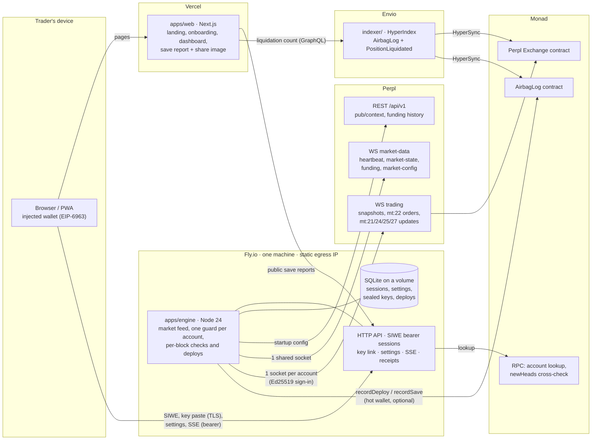

# Architecture

Airbag watches Perpl positions every Monad block and, when a position crosses its Airbag line, trims it with a reduce-only close and re-adds the released margin so the liquidation price moves away (ADR 0002). Decisions behind each part are in `docs/adr/`.

## System



The web app has no database and no secrets: everything goes through the engine's API (ADR 0010). The engine is the only process that can decrypt a Perpl key (ADR 0006).

## Packages

| Path | What | Depends on |
|---|---|---|
| `packages/risk` | Pure risk math: equity, liquidation price, the Airbag line, deploy planning (spare margin or trim, with the cap), trim application, save value; display formatting. No I/O, no dependencies. Runs in the engine and in the browser (settings preview, landing replay). | nothing |
| `packages/perpl` | Perpl client: context and funding REST, frame types, Ed25519 sign-in, `TradingClient` (snapshots, heartbeat `sn`, pings, token bucket, reconnect, order outcomes), `MarketFeed` (heartbeat, marks, funding, config, stale guard), onchain reads, unit conversion with safe rounding, and **the order-type allowlist**. | `risk`, viem |
| `apps/engine` | The always-on service: config, logger, SQLite store, key vault, the per-account guard, the paper exchange and simulation, the HTTP API, Web Push, the AirbagLog writer. | `risk`, `perpl`, viem, web-push |
| `apps/web` | Next.js site and app (ADR 0007, 0013). | `risk`, viem, next |
| `contracts/` | Foundry project: `AirbagLog` and its tests (ADR 0009). | — |
| `indexer/` | Envio HyperIndex project over AirbagLog and Perpl's liquidations (ADR 0009). | envio |
| `e2e/` | Playwright journeys with axe checks, against the engine in simulation mode. | — |
| `spike/` | M0 scripts for the owner's go/no-go run on testnet. | `perpl`, `risk` |

## The per-block loop

`MarketFeed` calls `Engine.tick(head)` on every Perpl heartbeat (one per Monad block). For each linked account the guard values every covered position at the mark and acts if equity has fallen to the line.

```mermaid
sequenceDiagram
  autonumber
  participant MD as Perpl market-data WS
  participant G as Guard (per account)
  participant TR as Perpl trading WS
  participant L as AirbagLog

  MD->>G: heartbeat (head k), marks already applied
  G->>G: stale? paused? key or forwarding blocked? then skip
  G->>G: equity(mark) ≤ Q for a covered position?
  Note over G: deploy starts; the position's lock is taken; phase persisted
  alt spare margin alone reaches the target
    G->>TR: mt:22 t:6, the smallest amount that does
  else trim
    G->>TR: mt:22 t:3/4, IOC, worst price 0.5% from mark, lots rounded up
    TR-->>G: mt:3 code 0 (accepted, not filled)
    TR-->>G: mt:24 final, mt:27 smaller position (deposit pro-rata), mt:21 balance
    G->>TR: mt:22 t:6 the released equity (balance change, capped by the model)
    TR-->>G: mt:27 deposit restored
    opt partial fill or no fill
      G->>G: retry next block, up to MAX_DEPLOY_ATTEMPTS, within the episode's cap
    end
  end
  G->>G: re-arm: reference = fill price, new line, lock released
  G-->>L: recordDeploy (queued, never blocks)
  G-->>G: push notification; SSE to the dashboard
  Note over G: later blocks: old liquidation price reached while open = save (recordSave), closed first = precaution
```

A restart between the close and the re-add is finished on the next snapshot: the guard compares the position with the state recorded when the close was sent and re-adds what's missing, unless the deposit shows it already landed.

## Invariants (enforced in code, tested)

1. Only order types **3, 4, 6** and **5** leave the engine: by type (the builders), by a runtime assert right before `send`, and by tests, including the paper exchange asserting every frame (ADR 0003). The only cancel is the link-time scope probe, which targets an order id that isn't one of the account's open orders.
2. Nothing is sent while data is stale (no heartbeat within `(STALE_BLOCKS + 1) × 400 ms`, or Perpl's head more than `STALE_BLOCKS` behind Monad's), while paused, key-rejected, frozen, or with order forwarding off.
3. One deploy in flight per position. `rq` strictly increasing per account, seeded from `Account.lfr`; unique `sn` per frame.
4. Outcomes come from positions, balances and `mt:24`, never from `mt:3`.
5. The API secret is decrypted only in engine memory and never logged or returned (ADR 0006).

## Modes

- **Live** (`ENGINE_MODE=live`): Perpl's context, feeds and trading sockets; requires `MASTER_KEY`.
- **Simulation** (`ENGINE_MODE=simulation`): the same engine on paper accounts and scripted prices (ADR 0012). Every screen says so. CI and the end-to-end tests run here.

## Networks

Everything network-specific (URLs, chain id, exchange and collateral addresses, market ids, decimals, margins, `order_ttl_blocks`) comes from `GET /api/v1/pub/context` at startup, plus live `market-config` updates. Env vars pick the network and override URLs. See `.env.example`.
