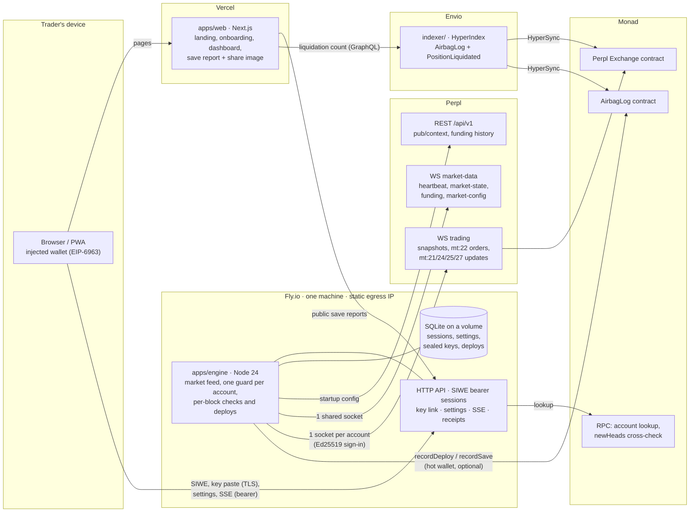

# Architecture

Airbag watches Perpl positions every Monad block and, when a position crosses its Airbag line,
trims it with a reduce-only close and re-adds the released margin so the liquidation price moves
away ([ADR 0002](adr/0002-deploy-is-close-then-readd.md)). The arithmetic is in
[RISK-MODEL.md](RISK-MODEL.md); the protocol it acts on is in [PERPL.md](PERPL.md). The decision
behind each part is in [adr/](adr/).

## System



The web app has no database and no secrets: everything goes through the engine's API
([ADR 0010](adr/0010-engine-owns-state-in-sqlite.md)). The engine is the only process that can
decrypt a Perpl key ([ADR 0006](adr/0006-api-key-custody.md)).

## Packages

| Path | What | Depends on |
|---|---|---|
| `packages/risk` | Pure risk math: equity, liquidation price, the Airbag line, deploy planning (spare margin or trim, with the cap), trim application, save value, display formatting. No I/O, no dependencies. Runs in the engine and in the browser (settings preview, landing replay). | nothing |
| `packages/perpl` | Perpl client: context and funding REST, frame types, Ed25519 sign-in, `TradingClient` (snapshots, heartbeat `sn`, pings, token bucket, reconnect, order outcomes), `MarketFeed` (heartbeat, marks, funding, config, stale guard), onchain reads, unit conversion with safe rounding, and **the order-type allowlist**. | `risk`, viem |
| `apps/engine` | The always-on service: config, logger, SQLite store, key vault, the per-account guard, the paper exchange and simulation, the HTTP API, Web Push, the AirbagLog writer. | `risk`, `perpl`, viem, web-push |
| `apps/web` | Next.js site and app ([ADR 0007](adr/0007-web-app.md), [0013](adr/0013-web-css-and-viem.md)). Design system and content contract: [apps/web/DESIGN.md](../apps/web/DESIGN.md). | `risk`, viem, next |
| `contracts/` | Foundry project: `AirbagLog` and its tests ([ADR 0009](adr/0009-onchain-log-and-indexer.md)). | — |
| `indexer/` | Envio HyperIndex over AirbagLog and Perpl's liquidations. | envio |
| `e2e/` | Playwright journeys with axe checks, against the engine in simulation mode. | — |
| `spike/` | Scripts for the one-off testnet verification run. See [DEPLOY.md](DEPLOY.md). | `perpl`, `risk` |

## The per-block loop

`MarketFeed` calls `Engine.tick(head)` on every Perpl heartbeat (one per Monad block). For each
linked account the guard values every covered position at the mark and acts if equity has fallen to
the line.

```mermaid
sequenceDiagram
  autonumber
  participant MD as Perpl market-data WS
  participant G as Guard (per account)
  participant TR as Perpl trading WS
  participant L as AirbagLog

  MD->>G: heartbeat (head k), marks already applied
  G->>G: stale? paused? key or forwarding blocked? then skip
  G->>G: equity(mark) ≤ Q for a covered position?
  Note over G: deploy starts; the position's lock is taken; phase persisted
  alt spare margin alone reaches the target
    G->>TR: mt:22 t:6, the smallest amount that does
  else trim
    G->>TR: mt:22 t:3/4, IOC, worst price 0.5% from mark, lots rounded up
    TR-->>G: mt:3 code 0 (accepted, not filled)
    TR-->>G: mt:24 final, mt:27 smaller position (deposit pro-rata), mt:21 balance
    G->>TR: mt:22 t:6 the released equity (balance change, capped by the model)
    TR-->>G: mt:27 deposit restored
    opt partial fill or no fill
      G->>G: retry next block, up to MAX_DEPLOY_ATTEMPTS, within the episode's cap
    end
  end
  G->>G: re-arm: reference = fill price, new line, lock released
  G-->>L: recordDeploy (queued, never blocks)
  G-->>G: push notification; SSE to the dashboard
  Note over G: later blocks: old liquidation price reached while open = save (recordSave), closed first = precaution
```

A restart compares fresh snapshots with persisted pre-order state and exact re-add targets.
It waits beyond the last order's execution deadline before retrying, so an original order
still in transit cannot be followed by a duplicate. Recovery stays pending while paused,
stale, frozen or forwarding is off. Rejected recovery consumes the retry budget and never
becomes a successful receipt merely because the recovery code ran.

## Invariants

Enforced in code and covered by tests.

1. Only order types **3, 4, 6** and **5** leave the engine: by type (the builders can only produce
   `OrderRequest<AllowedOrderType>`), by a runtime assert immediately before `socket.send`, and by
   tests, including the paper exchange asserting every frame
   ([ADR 0003](adr/0003-engine-runtime.md)). The only cancel is the link-time scope probe, which
   targets an order id that is not one of the account's.
2. Nothing is sent while data is stale (no heartbeat within `(STALE_BLOCKS + 1) × 400 ms`, or
   Perpl's head more than `STALE_BLOCKS` behind Monad's), while paused, key-rejected, frozen, or
   with order forwarding off.
3. One deploy in flight per position. `rq` strictly increasing per account, seeded from
   `Account.lfr`; unique `sn` per frame. Guard orders persist explicit `head + order_ttl_blocks`
   deadlines before dispatch. Unknown outcomes retain their lock until safe reconciliation;
   unlink/replacement checks that lock independently of the displayed status.
4. Outcomes come from positions, balances and `mt:24`, never from `mt:3`.
5. Socket startup times out after 10 s and shutdown cancels opening and request-budget waits.
   Open sockets close after 10 s of silence and reconnect. The dashboard also detects silence;
   the engine publishes stale state without relying on a new block to arrive.
6. The API secret is decrypted only in engine memory and never logged or returned
   ([ADR 0006](adr/0006-api-key-custody.md)).

## Modes

- **Live** (`ENGINE_MODE=live`): Perpl's context, feeds and trading sockets; requires `MASTER_KEY`.
- **Simulation** (`ENGINE_MODE=simulation`): the same engine, guard and API on paper accounts and
  scripted prices ([ADR 0012](adr/0012-exchange-port-and-simulation.md)). Every screen says so. CI
  and the end-to-end tests run here. The simulation's `POST /v1/sim/*` controls 404 in live mode.
  Blocks are shared; prices are per wallet (`SimChain.feedFor`), so one visitor's wick or reset
  never moves another visitor's positions on a public demo engine. The blocks are Monad testnet's
  own, from Perpl's public heartbeat, with a local clock filling in while it is quiet
  ([ADR 0014](adr/0014-simulation-on-monad-blocks.md)); `SIM_CLOCK=local` never connects.

SQLite is bound to mode and chain id. Local default files are
`data/airbag-<mode>-<network>.db`; an explicit path still must match the stored identity.
Populated legacy files require an operator backup and explicit binding. `/health` provides
process diagnostics; `/ready` returns 503 when the engine/feed cannot protect positions.
Fly, Docker and CI use readiness. It is a service-wide check; individual key problems remain
visible in each account's status.

## The web app

Next.js App Router. Server components for the public pages, client components for the live views.
`/s/[id]` renders its share image with `next/og` at 1200×675. The session is a bearer token in
`localStorage`, and the live dashboard is server-sent events read with `fetch`, because
`EventSource` cannot send headers ([ADR 0011](adr/0011-bearer-sessions.md)).

| Route | What |
|---|---|
| `/` | Landing, with the crash-test replay driven by `@airbag/risk` |
| `/connect` | Wallet connect (EIP-6963) and Perpl account lookup |
| `/link-key` | Paste a Perpl Trade key, run the scope probe, show the engine's egress IPs |
| `/setup` | Sensitivity, trim target, max trim, spare margin, alerts, with the live preview |
| `/app` | Dashboard: the primary flight display, runways, the per-block strip, key health |
| `/app/deploys`, `/app/deploys/[id]` | Deploy receipts and detail |
| `/app/settings` | The same controls outside the stepper |
| `/s/[id]` | Public save report and its share image |

The engine's HTTP API is `apps/engine/src/api.ts`, one `route()` call per endpoint, with its CORS,
body-size and per-IP rate-limit options in the same place.

## Networks

Everything network-specific (URLs, chain id, exchange and collateral addresses, market ids,
decimals, margins, `order_ttl_blocks`) comes from `GET /api/v1/pub/context` at startup, plus live
`market-config` updates. Env vars pick the network and override URLs; see `.env.example` and
[PERPL.md](PERPL.md).

## Known limits

Accepted for now, and worth knowing before changing anything near them.

- The public save report caches the engine's reading for 30 s and Next serves the old copy while it
  refreshes (`apps/web/lib/save.ts`), so "now, BTC is at …" can lag the market. The figures always
  match the price the page states. Save links are `prefetch={false}` for the same reason: the kept
  amount moves with the price, so an early fetch plants a stale snapshot.
- Counterfactual returns use a shared liquidation-user share read from the first covered market,
  with a 0.8 fallback, and estimate a fill at the old liquidation price. Market-specific shares,
  liquidation slippage and later external changes are not reconstructed.
- One engine process on one machine: if it is down, nothing is protected. Put an external uptime
  check on `/ready` when it is deployed.
- The dashboard stream sends the whole state every block to every open tab. Fine for tens of users,
  not thousands.
- The scope probe uses a high safe uint64 id outside the snapshot, avoiding the old low-id race.
  Its live acceptance is still unverified; there is no authoritative scope-introspection API.
- Live startup requires funding and fee schedules. Unknown data blocks protection rather than
  silently valuing funding or fees as zero. Fee estimates can still change at execution time.
- Pausing mid-deploy leaves recovery pending until re-armed. Target, trim cap and spare policy
  are frozen for that episode; changes apply to the next episode.
- Concurrent user trades or manual collateral moves can make snapshot-based reconciliation
  ambiguous. Recovery checks position/account identity, but cannot attribute every external
  mutation. Disposable testnet chaos testing and independent review remain launch gates.
- The optional onchain writer has an in-memory queue, without durable retry or a persistent
  outbox. Receipts survive in SQLite, but failed log writes require operator investigation and
  are not silently backfilled on restart. The contract is writer-attested, not independent proof
  that a counterfactual liquidation would have occurred.
- The session token lives in `localStorage`. The CSP limits where a script could send it, but Next's
  inline scripts need `'unsafe-inline'`.
