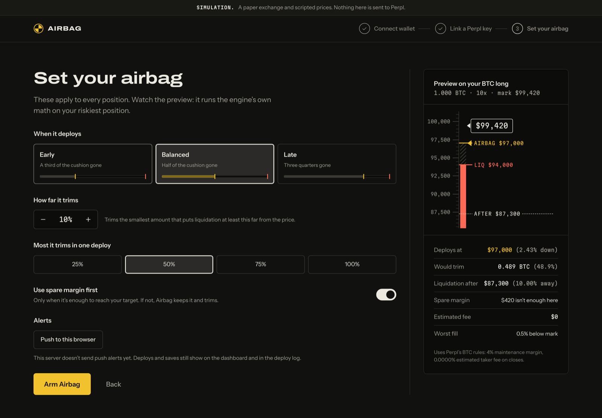
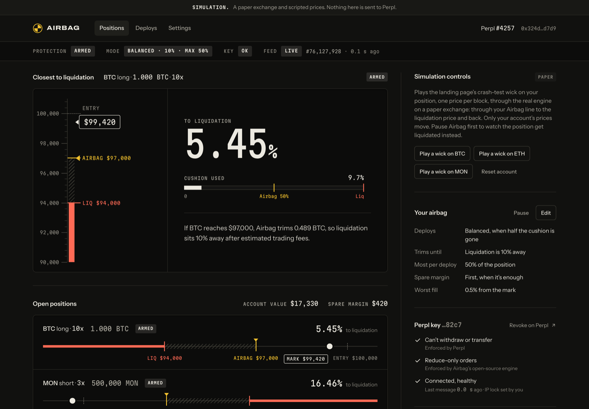
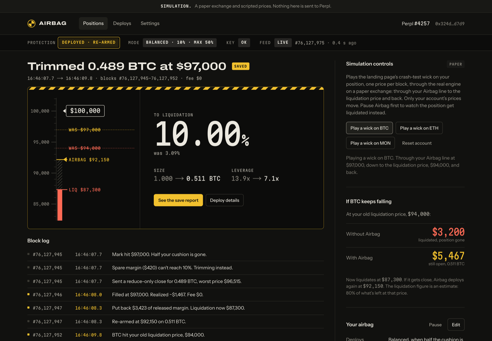

# User guide

[Documentation](README.md) · [Risk model](RISK-MODEL.md) · [Verification status](VERIFICATION.md)

Airbag monitors isolated-margin Perpl positions and acts when they reach the configured Airbag
line. It can reduce exposure or add available margin. Protection depends on fresh data, available
collateral, order-book fills and service uptime; it cannot guarantee that a position avoids liquidation.

## Choose the environment

The public app at [airbag.user64bit.world](https://airbag.user64bit.world) is a simulation. Test-wallet
connect and test-key linking create paper accounts; scripted wicks exercise the same guard used by
the live engine. Its block numbers follow Monad testnet when available. A local-clock fallback is
identified in the dashboard. Simulated transactions are not real exchange fills.

Live trading has been verified on Perpl testnet. Mainnet trading is not released. Read
[Verification status](VERIFICATION.md) before using a live deployment.

## Try the simulation first

No funds, wallet extension or real API key are needed.

1. Open [Connect](https://airbag.user64bit.world/connect), choose **Connect a test wallet**, and sign in.
2. Choose **Use a test key**, select **Verify key**, then **Set your airbag**. Review the preview
   and arm Airbag.
3. On the dashboard, **Pause** Airbag and select **Play a wick on BTC**. The paper position liquidates.
4. Select **Reset account**, **Resume** Airbag, and play the BTC wick again. Inspect the trim,
   collateral re-add and save report.

Try ETH for spare-margin protection and MON for a short. Scripted prices and resets are isolated
to your wallet. Wait for an in-flight deploy to finish before resetting; reset retains receipt history.
The examples use zero trading fees, not live execution costs.

## Setup

1. **Connect and sign in.** Connect an injected wallet such as Rabby or MetaMask, or select
   **Connect a test wallet** in simulation. Connecting reads your address; signing the sign-in
   message authorizes an Airbag session, not spending. Live mode needs an existing Perpl account.
2. **Link a key.** In simulation, use the provided test key. On testnet, create a Perpl Trade key,
   enable One-Click Trading and restrict the key to the engine's displayed egress IPs. If the operator
   has not published fixed egress IPs, the UI can accept an explicitly unlocked key; that is not an
   IP lock and is unsuitable for real-money operation. In live mode, Airbag checks wallet ownership
   and Trade-scope admission. Perpl exposes no IP-list readback; the restriction is your confirmation.
   Never submit real credentials to simulation or share a key in chat or an issue.
3. **Review and arm.** Choose a policy and review the preview. Airbag remains paused until armed.
   Coverage defaults to BTC, ETH and MON; the deployment configuration determines the actual list.

*Review the preview before arming. The example is a paper account; actual fees, fills and available
margin determine a live result.*

Perpl API keys cannot withdraw or transfer, but a stolen Trade key can trade. Airbag itself permits
only reduce-only closes, collateral adds and the one link-time cancel probe. Revoke a compromised
key on Perpl immediately; logging out of Airbag does not revoke it.

## Settings

| Setting | Behavior |
|---|---|
| Early / Balanced / Late | Acts after one-third / one-half / three-quarters of the reference margin cushion is used |
| Target distance | Desired liquidation distance after acting; default 10%, configurable from 6% to 20% |
| Maximum trim | Cap on the original size trimmed in one protection episode: 25%, 50%, 75% or 100%; default 50% |
| Use spare margin | Adds only the amount needed when free balance alone can reach the target; otherwise trims |
| Push to this browser | Browser notification preference and subscription; separate from Telegram linkage |
| Pause / resume | Controls future dispatches; an order already sent can still execute |

Settings changed during a deploy apply to the next episode; the in-progress target, cap and spare
policy are preserved. Pausing can leave a collateral re-add awaiting recovery. Inspect Perpl if a
trim has filled but its re-add remains pending. Key replacement and unlinking are held while a
deploy needs reconciliation.

Operator-allowlisted test wallets may see **Demo mode**, which acts after a 0.3% adverse move.
This is for testnet verification and is not a recommended trading policy.

## Read the dashboard

- **Armed / Deployed · re-armed:** the guard can evaluate covered positions on fresh data.
- **Deploying:** a close, margin add, re-add or recovery is in progress. Open its block log.
- **Paused:** no new orders will be dispatched until resumed.
- **Data stale · holding / Connecting:** protection is waiting for usable data or a connection.
- **Key rejected · relink:** check revocation, expiration, secret and the IP allow-list.
- **One-Click Trading off:** enable order forwarding in Perpl.
- **Perpl connection limit:** close extra Perpl tabs; connections are shared with Airbag.
- **Account frozen:** resolve the account's state in Perpl.
- **Not covered:** displayed for visibility; Airbag does not act on that market.

A site-wide ready response does not prove every account's key is healthy. The dashboard gives the
account-specific status. If protection fails or reaches its retry limit, inspect the position and
released collateral on Perpl rather than assuming the target was reached.

## Receipts and save reports

A deploy receipt records the trigger, fills, fees, collateral movements and before/after levels.
A **save** means the old liquidation price was later reached while that position stayed open.
A **precaution** means it closed before that crossing. A completed deploy can remain awaiting that
classification while the position is open.

*A receipt records what happened. Open the timeline when a deploy is pending or failed; a submitted
order or gateway acknowledgement is not proof of a fill.*

The counterfactual liquidation return is an estimate. Save values exclude spare collateral Airbag
added, update while the position stays open, and freeze when it closes. Public reports and share
images can lag by their cache interval. Anyone with a save link can read its report; keep the link
private if you do not want to share those figures.

Protection can cost money when the market recovers: the trimmed part misses that recovery. A
continued adverse move can liquidate the smaller position and return less than the original
liquidation would have. [Historical replays](https://airbag.user64bit.world/backtest) show both sides
and list the fill assumptions.

## Alerts

**Push to this browser** subscribes this device. Browser permissions, network access and push
provider delivery still apply. Some browsers require installation or additional push settings;
alert delivery is not proof of protection. Telegram linking uses a one-use Start link; `/stop` or
unlinking in Settings removes the chat. The push preference controls **Web Push only**; turning
it off does not stop Telegram. Unlink Telegram or send `/stop` to stop that channel.

## Troubleshooting

If sign-in fails after a hostname change, the operator must match `WEB_ORIGIN` to the site.
If the dashboard stops updating, check your connection and the engine status; stale data blocks
dispatch. In simulation, **Reset account** restores sample positions and prices once any in-flight
deploy is finished. Resetting and playing wicks affect only your simulated wallet.

For a failed live deploy, inspect the receipt and Perpl first, then contact the operator with the
deploy id and request id. Never include API secrets or session tokens.
